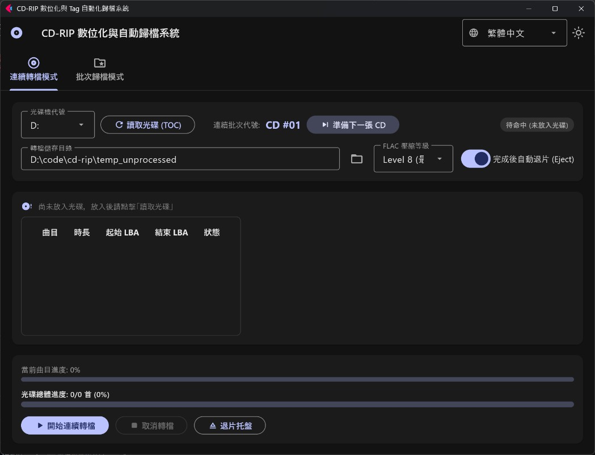
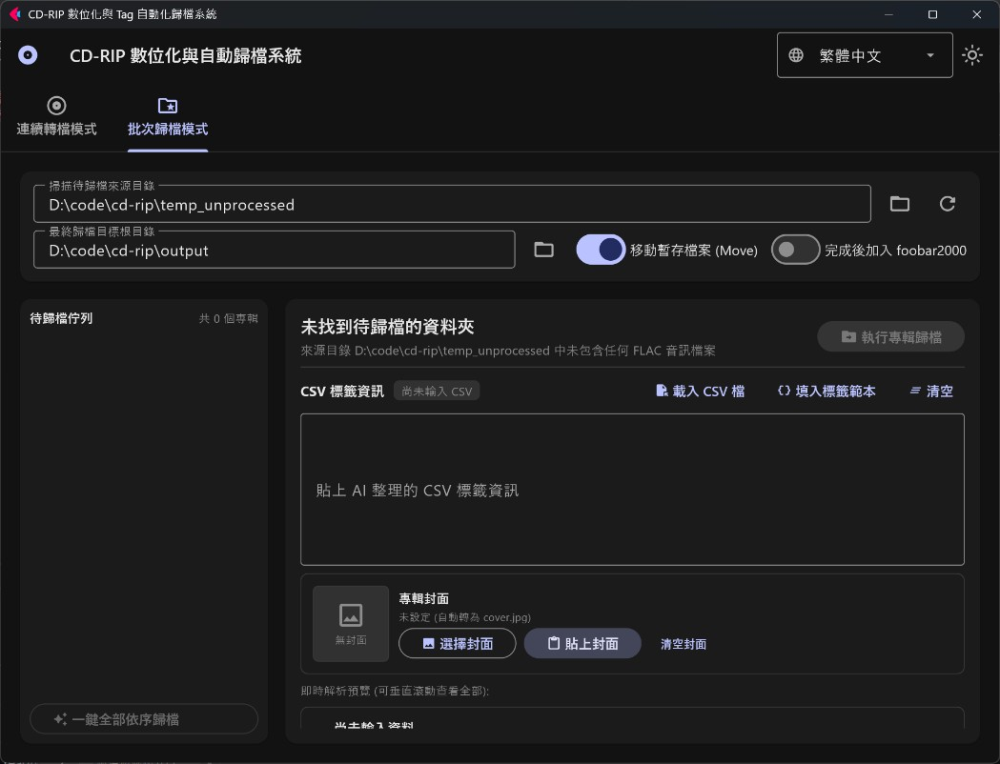

[繁體中文](README.md) | [English](readme_en.md) | [日本語](readme_jp.md)

# CD 數位化與 Tag 自動化歸檔系統 (CD-RIP Tool)

本專案提供一套高效、自動化的同人場 / 音樂 CD 數位化解決方案。透過原生 Windows SCSI MMC 協定進行 bit-perfect 無損音訊擷取，支援 FLAC 最高等級壓縮 (Level 8)、AI 元資料 CSV 標籤寫入、剪貼簿封面圖片內嵌，以及多語系 Material 3 桌面圖形介面。

---

## 🎬 實機操作展示 (Workflow Demo)

<div align="center">
  <video src="images/demo_edited.mp4" controls width="100%" style="max-width: 860px;"></video>
  <p><em>▲ 完整操作示範：從光碟音訊擷取、AI 標籤解析到批次歸檔流程（若瀏覽器不支援內嵌播放，請<a href="images/demo_edited.mp4">點此觀看 Demo 影片</a>）</em></p>
</div>

---

## 📸 介面與功能導覽 (Interface Walkthrough)

### 1. 連續轉檔分頁 (Continuous Ripping)
> **原生光碟音訊擷取**：免安裝 EAC 等外部軟體，即時顯示各音軌進度與整體進度，擷取完畢智慧自動退片，專為多張 CD 連續數位化打造。

<p align="center">
  
</p>

### 2. 批次歸檔分頁 (Batch Archiving & AI Tagging)
> **AI 標籤解析與封面內嵌**：貼上 AI 整理的曲目 CSV 立即自動生成預覽表格；支援剪貼簿直接貼上封面圖檔 (`Ctrl+V`)，一鍵批次完成寫標籤、轉碼與目錄整理。

<p align="center">
  
</p>

---

## 🌟 系統特色 (Features)

1. **現代化 Material 3 桌面介面**：採用 Flet 打造，支援多國語言即時切換（繁體中文、English、日本語、简体中文）與深淺主題模式。
2. **原生 Bit-Perfect CD 擷取**：直接透過 Windows 原生 SCSI MMC 指令對光碟機進行數位音訊擷取 (DAE)，**無需安裝外部轉碼或擷取軟體**。
3. **高品質 FLAC 壓縮**：支援 16-bit 44.1kHz 雙聲道無損 FLAC 輸出（預設最高等級 Level 8 壓縮）。
4. **高效雙分頁作業流程**：
   - **連續轉檔分頁**：即時讀取目錄、雙進度條顯示、高速批次連續壓片與轉檔完成智慧自動退片。
   - **批次歸檔分頁**：AI CSV 標籤解析與曲目即時預覽、剪貼簿圖片 / 檔案選取封面內嵌、單張與全量依序批次歸檔。
5. **便捷標籤與封面處理**：支援直接在 UI 貼上 AI 產生的 CSV 內容與剪貼簿封面圖檔 (`Ctrl+V`)，自動轉換為相容性最佳的標準 `cover.jpg`。
6. **零配置自動就緒**：首度啟動會自動依應用程式所在位置動態產生本機預設目錄，開箱即用。

---

## 🛠️ 環境與安裝需求 (Requirements & Installation)

* **作業系統**：Windows 10 / 11 (64-bit)
* **Python 版本**：Python 3.10+
* **相依套件安裝**：
  在專案根目錄開啟終端機執行：
  ```bash
  pip install -r requirements.txt
  ```

---

## 🚀 啟動與使用方式 (Quick Start)

### 方式一：直接下載執行檔（推薦，免安裝 Python）
一般使用者無需安裝 Python 環境，可直接前往專案的 [Releases](../../releases) 頁面下載最新版發布檔（例如 `CD-Rip-Tool-windows-x64.zip`）。解壓縮後直接執行 `CD-Rip-Tool.exe` 即可開箱使用。

### 方式二：從原始碼執行
若欲自行客製或二次開發，請先完成上述套件安裝後執行：
```bash
python main.py
```

---

## 🤖 AI 專輯資訊產生提示詞 (AI Metadata Prompt)

在進行「批次歸檔」時，本工具支援直接將 AI（如 Gemini、ChatGPT、Claude）搜尋並整理好的 CSV 格式文字貼入文字框中，系統即可自動解析並寫入音訊標籤與重新命名。

### 📖 如何產生專輯 CSV 與封面？

1. 複製下方的 **AI Prompt 提示詞**。
2. 開啟 AI 對話模型（建議使用具備聯網搜尋能力的模型，如 Gemini 或 ChatGPT Plus）。
3. 將 Prompt 連同您要處理的**專輯名稱、社團名稱、發售展會（如 M3、Comiket）或作品頁面連結**一起送出給 AI。
4. AI 將會檢索詳細曲目清單、主唱、作曲者、作詞者等資訊，並以標準 CSV 代碼區塊輸出，同時附上高解析度封面連結。
5. 在本工具的「批次歸檔」分頁中：
   - 將代碼區塊內的 CSV 文字複製並貼入「CSV 標籤文字」欄位，下方曲目清單會立即自動預覽。
   - 複製 AI 提供的封面圖片（或在瀏覽器複製圖片）後，在工具內點擊「從剪貼簿貼上」或按 `Ctrl+V` 即可完成封面設定。

---

### 📋 AI Prompt (英文標準版 / English Prompt)

```text
You are a music assistant bot.
Search for album info in detail and organize it into CSV format.
The CSV string must be enclosed inside a ```csv ``` code block.
The CSV format must strictly follow the header below:

%track%,%title%,%genre%,%artist%,%year%,%album%,%albumartist%,%composer%,%lyricist%

Field rules:
1. Make sure all properties are included in the header. If a field value is unknown or not specified, leave it blank.
2. %track%: Track number padded with leading zero (e.g., 01, 02).
3. %title%: Track title.
4. %genre%: Music style or genre (e.g., J-Pop, Instrumental, Electronic, Rock).
5. %artist%: Track vocalist. If featuring multiple vocalists, use " & " to connect all vocalists.
6. %year%: Album release year (4 digits, e.g., 2026).
7. %album%: The name of the album.
8. %albumartist%: Circle name, band name, or main producer.
9. %composer%: The person who wrote the music or mastering/sound engineer. If not specified, leave empty.
10. %lyricist%: The person who wrote the lyrics. If not specified, leave empty.
11. Instrumental version tracks do NOT need %artist% and %lyricist% (leave both blank).

After the CSV code block, please also provide the direct link to the album cover image (preferably high resolution).

Album to search: [Insert Album Name / Circle / Catalog Number / Event here]
```
