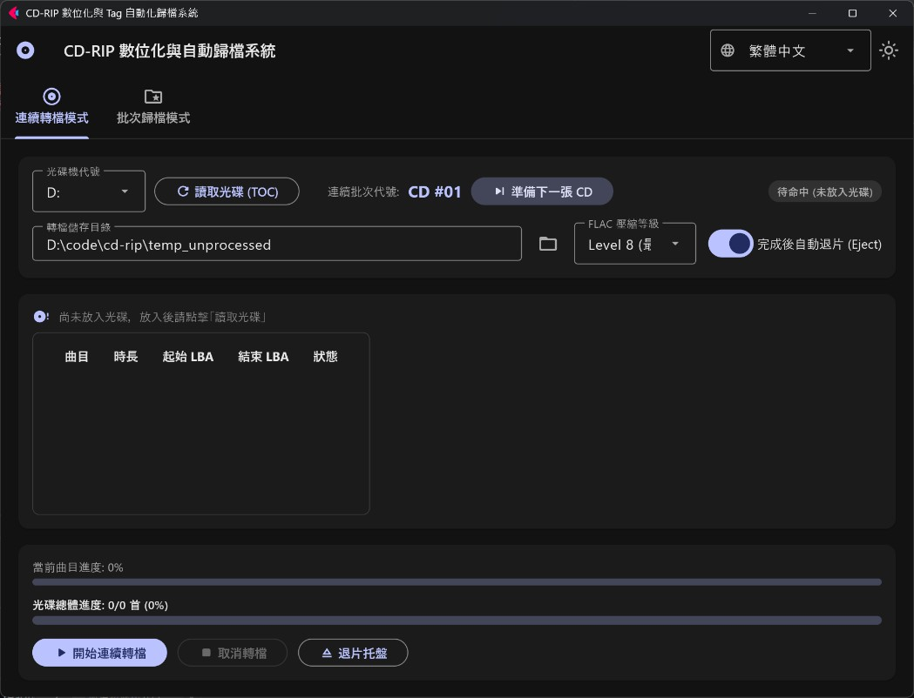
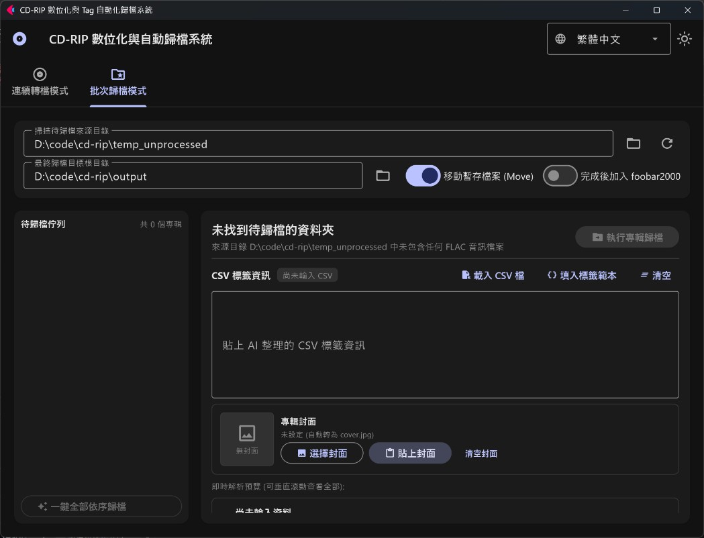

[日本語](readme_jp.md) | [繁體中文](README.md) | [English](readme_en.md)

# CD デジタル化＆タグ自動アーカイブシステム (CD-RIP Tool)

同人音楽・商業 CD 向けの高効率かつ自動化されたデジタルアーカイブツールです。Windows ネイティブの SCSI MMC プロトコルを用いたビットパーフェクトなロスレス音源抽出、FLAC 最高圧縮率（Level 8）、AI 生成 CSV によるメタデータ自動タグ付け、クリップボード画像によるアルバムアート埋め込み、多言語対応の Material 3 デスクトップ GUI を提供します。

---

## 🎬 操作デモ動画 (Workflow Demo)

<div align="center">
  <video src="images/demo_edited.mp4" controls width="100%" style="max-width: 860px;"></video>
  <p><em>▲ 操作フロー実機デモ：CD 音声抽出から AI タグ解析、一括アーカイブまで（<a href="images/demo_edited.mp4">Demo 動画の直接再生・ダウンロードはこちら</a>）</em></p>
</div>

---

## 📸 画面・機能紹介 (Interface Walkthrough)

### 1. 連続リッピングタブ (Continuous Ripping)
> **ネイティブ CD 音声抽出**：EAC 等の外部ソフト不要。トラック別および全体の進行状況をリアルタイム表示し、取り込み完了時に自動でドライブトレイを排出します。

<p align="center">
  
</p>

### 2. 一括アーカイブタブ (Batch Archiving & AI Tagging)
> **AI タグ解析＆ジャケット埋め込み**：AI が生成した曲目 CSV を貼り付けるだけで即座に表プレビュー。クリップボードからの画像貼り付け（`Ctrl+V`）に対応し、ワンクリックで FLAC タグ書き込みとフォルダ整理を完結します。

<p align="center">
  
</p>

---

## 🌟 主な特徴 (Features)

1. **モダンな Material 3 デスクトップ GUI**：Flet を採用し、実行時リアルタイム多言語切替（日本語、繁体中国語、英語、簡体中国語）とダーク／ライトテーマの切替に対応。
2. **ネイティブ・ビットパーフェクト CD リッピング**：Windows ネイティブの SCSI MMC コマンドで光学ドライブから直接デジタル音声抽出（DAE）を実施。**EAC などの外部リッピングソフトやエンコーダーの追加導入は一切不要**です。
3. **高品質 FLAC 圧縮**：16-bit 44.1kHz ステレオのロスレス FLAC 出力（デフォルトで最高圧縮の Level 8）。
4. **効率的な 2 タブ分割ワークフロー**：
   - **連続リッピングタブ**：TOC 即時読み込み、デュアルプログレスバー表示、高速連続リッピング、取り込み完了後の自動イジェクト（トレイ排出）。
   - **一括アーカイブタブ**：AI CSV メタデータ解析とトラック一覧プレビュー、クリップボード貼り付け／ファイル選択によるジャケット画像埋め込み、個別・一括自動アーカイブ。
5. **快適なタグ付け＆カバーアート処理**：AI が生成した CSV やクリップボードにコピーした画像（`Ctrl+V`）を UI に直接貼り付け可能。互換性の高い標準的な `cover.jpg` に自動変換されます。
6. **ゼロコンフィグですぐに利用可能**：初回起動時、アプリの配置場所に合わせて自動でデフォルトパスを生成・設定します。

---

## 🛠️ 動作環境とインストール要件 (Requirements & Installation)

* **対応 OS**：Windows 10 / 11 (64-bit)
* **Python バージョン**：Python 3.10+
* **依存パッケージのインストール**：
  プロジェクトのルートディレクトリで以下のコマンドを実行してください：
  ```bash
  pip install -r requirements.txt
  ```

---

## 🚀 起動方法とダウンロード (Quick Start)

### 方法 1: リリースから実行ファイルを直接ダウンロード（推奨・Python 環境不要）
一般的なご利用の場合、Python 環境の構築は不要です。[Releases](../../releases) ページから最新のリリースパッケージ（例: `CD-Rip-Tool-windows-x64.zip`）を直接ダウンロードしてください。解凍後、フォルダ内の `CD-Rip-Tool.exe` を起動するだけですぐにご利用いただけます。

### 方法 2: ソースコードから実行
開発やカスタマイズを行う場合は、上記の依存パッケージを導入した上で以下を実行します：
```bash
python main.py
```

---

## 🤖 AI アルバム情報生成プロンプト (AI Metadata Prompt)

「一括アーカイブ」タブでは、AI（Gemini、ChatGPT、Claude など）が検索・整理した CSV 形式のテキストを貼り付けるだけで、楽曲タグの書き込みとファイル名のリネームを自動実行できます。

### 📖 アルバム CSV とジャケット画像の生成手順

1. 下記の **AI プロンプト** をコピーします。
2. Web 検索が可能な AI モデル（Gemini、ChatGPT Plus など推奨）を開きます。
3. プロンプトに対象の**アルバム名、サークル名、頒布イベント（M3、コミケ等）、または作品ページ URL** を添えて送信します。
4. AI が詳細なトラックリスト、ボーカル、作曲者、作詞者等を検索し、規格化された CSV コードブロックと高解像度ジャケット画像のリンクを出力します。
5. CD-RIP Tool の「一括アーカイブ」タブで：
   - 出力された CSV テキストを「CSV タグテキスト」欄に貼り付けると、下の表にトラック一覧が即座にプレビューされます。
   - ジャケット画像をコピーして「クリップボードから貼り付け」をクリックするか、`Ctrl+V` を押してジャケットを設定します。

---

### 📋 AI プロンプト（標準英文版 / English Prompt）

```text
You are a music assistant bot.
Search for album info in detail and organize it into CSV format.
The CSV string must be enclosed inside a ```csv ``` code block.
The CSV format must strictly follow the header below:

%track%,%title%,%genre%,%artist%,%year%,%album%,%albumartist%,%composer%,%lyricist%

Field rules:
1. Make sure all properties are included in the header. If a field value is unknown or not specified, leave it blank.
2. %track%: Track number padded with leading zero (e.g., 01, 02).
3. %title%: Track title.
4. %genre%: Music style or genre (e.g., J-Pop, Instrumental, Electronic, Rock).
5. %artist%: Track vocalist. If featuring multiple vocalists, use " & " to connect all vocalists.
6. %year%: Album release year (4 digits, e.g., 2026).
7. %album%: The name of the album.
8. %albumartist%: Circle name, band name, or main producer.
9. %composer%: The person who wrote the music or mastering/sound engineer. If not specified, leave empty.
10. %lyricist%: The person who wrote the lyrics. If not specified, leave empty.
11. Instrumental version tracks do NOT need %artist% and %lyricist% (leave both blank).

After the CSV code block, please also provide the direct link to the album cover image (preferably high resolution).

Album to search: [Insert Album Name / Circle / Catalog Number / Event here]
```
